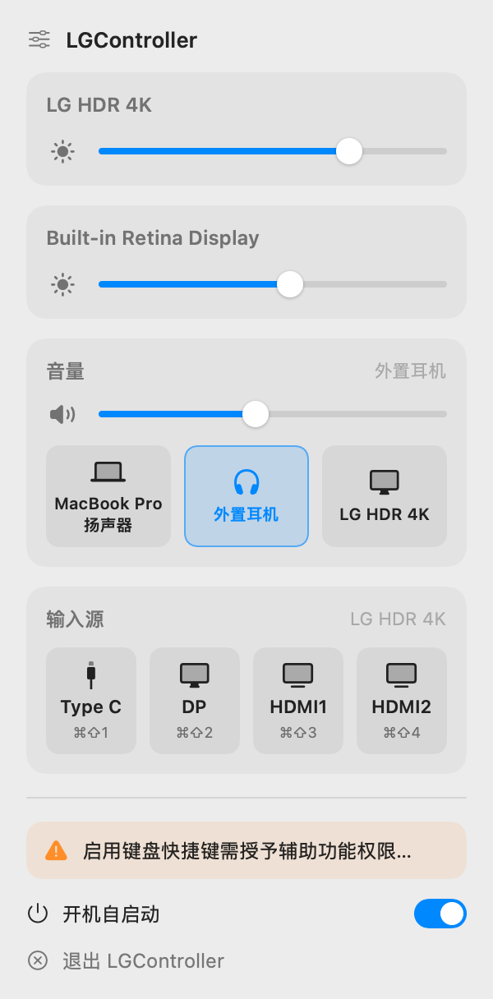

# LGController

macOS 菜单栏小工具：用 Mac 键盘的亮度 / 音量键和菜单栏弹窗，控制 **LG 外接显示器（及其他支持 DDC/CI 的显示器）和内建屏**的亮度、当前声音输出设备的音量，一键切换系统声音输出，并用 `⌘⇧1`～`⌘⇧4` 切换 LG 显示器的**输入源**。



> 上图用示例数据离屏渲染，不是真机截图。

完整手册：[中文](docs/USER_GUIDE.zh-CN.md) · [English](docs/USER_GUIDE.en.md)

---

## 目录

- [功能一览](#功能一览)
- [系统要求](#系统要求)
- [快速开始](#快速开始)
- [安装详解](#安装详解)
- [首次启动与授权](#首次启动与授权)
- [日常使用](#日常使用)
  - [键盘](#键盘)
  - [菜单栏弹窗](#菜单栏弹窗)
  - [切换 LG 输入源](#切换-lg-输入源)
  - [切换声音输出](#切换声音输出)
  - [开机自启动](#开机自启动)
- [命令行参数](#命令行参数)
- [更新](#更新)
- [从 Monitoring / SourceShift 迁移](#从-monitoring--sourceshift-迁移)
- [常见问题](#常见问题)
- [已知限制](#已知限制)
- [卸载](#卸载)
- [实现说明](#实现说明)
- [许可](#许可)

---

## 功能一览

| 功能 | 怎么用 | 说明 |
|---|---|---|
| 调亮度 | 亮度键（F1 / F2）或弹窗滑杆 | 调**鼠标所在**的那块屏；内建屏和苹果显示器走 DisplayServices，LG 等外接屏走 DDC/CI |
| 调音量 / 静音 | 音量键（F11 / F12）、静音键（F10）或弹窗「音量」卡片 | 调**当前声音输出设备**（耳机、AirPods、内建扬声器、USB 声卡），与鼠标位置无关；输出是显示器自带扬声器时经 DDC 调它 |
| 精细调节 | `⌥⇧` + 亮度 / 音量键 | 每档 1/64（默认 1/16） |
| 切换声音输出 | 弹窗「音量」卡片里的设备按钮 | 等同于在控制中心选输出设备 |
| 切换 LG 输入源 | `⌘⇧1`～`⌘⇧4` 或弹窗「输入源」卡片 | Type C / DP / HDMI1 / HDMI2；显示器正显示别的设备时也能「盲按」切回 Mac |
| 屏幕浮层 | 自动 | 调节时在屏幕右上角显示图标和进度条，仿 macOS 26 系统样式 |
| 开机自启动 | 弹窗开关 | 全新安装首次启动时自动开启 |

## 系统要求

- **macOS 12 或更高**。
- **Apple Silicon 或 Intel Mac**。Intel 上的 DDC（LG 亮度、扬声器音量、输入源切换）为**试验性支持**。
- **Xcode Command Line Tools**（Swift 5.7 或更高，即 Command Line Tools 14.1 起）。不需要完整的 Xcode。
- 显示器：亮度和扬声器音量适用于支持 DDC/CI 的外接显示器；输入源切换需要 **LG 显示器**，且取决于型号和固件（见[已知限制](#已知限制)）。
- 没有预编译安装包，需要从源码构建（一条命令）。

## 快速开始

在终端依次运行：

```bash
xcode-select --install
```

```bash
git clone https://github.com/Toyzcool/LGController.git ~/LGController
```

```bash
cd ~/LGController
```

```bash
./setup-codesign-identity.sh
```

```bash
./build.sh
```

```bash
open /Applications/LGController.app
```

然后在 **系统设置 → 隐私与安全性 → 辅助功能** 里打开 **LGController**（亮度 / 音量键要用）。完成后菜单栏会出现太阳图标。

## 安装详解

### 1. 安装命令行工具

```bash
xcode-select --install
```

已经装过会提示已安装，可以跳过。用下面的命令确认 Swift 版本 ≥ 5.7：

```bash
swift --version
```

### 2. 获取源码

```bash
git clone https://github.com/Toyzcool/LGController.git ~/LGController
```

### 3.（推荐）创建自签名证书

```bash
cd ~/LGController
```

```bash
./setup-codesign-identity.sh
```

只需运行一次。它在登录钥匙串里创建「LGController Self-Signed」代码签名证书，之后每次重新构建签名都保持不变，**辅助功能授权不会失效**。不建证书也能用，但每次重新构建后都要重新授权。

### 4. 构建并安装

```bash
./build.sh
```

脚本会：编译 → 组装 `LGController.app` → 签名 → 退出正在运行的旧版本 → 安装到 `/Applications/LGController.app`。成功时最后输出「✅ 已安装并签名」。

- 当前用户需要能写入 `/Applications`（一般是管理员账户）。
- 如果命令行工具里的 SwiftPM 不能用（报 `no such module 'PackageDescription'`），脚本会自动改用 `swiftc` 直接编译，首次可能要几分钟。
- 脚本不会自动启动 App。

### 5. 启动

```bash
open /Applications/LGController.app
```

App 只在菜单栏显示太阳图标，没有 Dock 图标和主窗口。

## 首次启动与授权

| 权限 | 用途 | 不授权会怎样 |
|---|---|---|
| **辅助功能** | 拦截亮度 / 音量 / 静音键 | 这些键交给 macOS 处理；弹窗、`⌘⇧1~4` 照常可用 |
| **控制「系统事件」**（仅 macOS 12） | 设置开机自启动 | 开机自启动开关打不开 |

授权辅助功能：

1. 首次启动时 macOS 会弹窗询问，选「打开系统设置」。
2. 在 **系统设置 → 隐私与安全性 → 辅助功能**（macOS 12：**系统偏好设置 → 安全性与隐私 → 隐私 → 辅助功能**）中打开 LGController。列表里没有就点「+」添加 `/Applications/LGController.app`。
3. App 每 3 秒检查一次；拿到权限后会**自动重启一次**再接管按键。
4. 验证：鼠标放到 LG 屏上按亮度键，屏幕右上角应出现浮层。

错过了系统弹窗：打开菜单栏弹窗，点橙色的「启用键盘快捷键需授予辅助功能权限…」。

## 日常使用

### 键盘

| 按键 | 作用 |
|---|---|
| 亮度加 / 减（F2 / F1） | 鼠标所在屏亮度 ±1/16 |
| 音量加 / 减（F12 / F11） | 当前输出设备音量 ±1/16（显示器扬声器为 ±1 个单位，LG 满格 100） |
| 静音（F10） | 切换当前输出设备静音，取消静音时恢复原音量 |
| `⌥⇧` + 亮度 / 音量键 | 精细调节，每档 1/64（显示器扬声器仍是 ±1） |
| `⇧` + 上述键 | 与不加 `⇧` 相同 |
| `⌥` + 亮度 / 音量键 | 交给 macOS（打开「显示器」/「声音」设置） |
| `⌘` 或 `⌃` + 媒体键 | 交给 macOS |
| `⌘⇧1` / `⌘⇧2` / `⌘⇧3` / `⌘⇧4` | LG 输入源切到 Type C / DP / HDMI1 / HDMI2 |

要点：

- **亮度跟着鼠标走**：先把鼠标移到要调的屏上再按键。
- **音量跟着声音输出走**：调的是声音实际从哪出的那个设备，与鼠标在哪无关。
- 调到 0 即真正静音；任意音量键都会解除静音（与 macOS 一致）。
- 某块屏不可控时，亮度键原样交给 macOS。
- **Touch Bar 机型**：拖动 Touch Bar 上的亮度滑条不产生按键事件，App 拦截不到。请点控制条左侧「‹」展开，用单独的亮度按钮，或用弹窗滑杆。

### 菜单栏弹窗

点菜单栏的太阳图标打开，每次打开都会重新读取显示器的当前值。从上到下：

1. **显示器卡片**：每台显示器一个亮度滑杆。接了两台及以上可 DDC 调音量的显示器时，「音量」卡片没在控制的那几台还会多一行扬声器音量。
2. **「音量」卡片**：标题右侧是当前输出设备名（经 DDC 调显示器扬声器时显示「· DDC」）；滑杆调音量，点左侧扬声器图标静音；下方按钮切换声音输出。
3. **「输入源」卡片**：标题右侧是将接收命令的显示器；四个按钮对应 `⌘⇧1~4`。
4. **辅助功能提示**（仅未授权时出现）、**开机自启动**开关、**退出 LGController**。

弹窗里的调节立即生效，不显示浮层；键盘调节时弹窗里的滑杆会实时联动。

### 切换 LG 输入源

1. **选目标**：只接一台 LG 时，鼠标在哪都行。接了多台时，用快捷键前把鼠标移到要切的屏上；用弹窗按钮时，目标是「输入源」卡片标题右侧显示的那台。
2. **发送**：按 `⌘⇧1`～`⌘⇧4`，或点弹窗按钮。
3. **看反馈**（显示在鼠标所在屏）：
   - 「已发送切换 → HDMI1」：显示器收到了命令。**不代表已经切换**，以显示器画面为准（这个命令只写不可读）。
   - 提示音 +「HDMI1 未送达显示器」：自动重试后仍未送达。
4. **切回 Mac**：即使显示器没在显示 Mac 的画面，按 Mac 所接口对应的快捷键即可（USB-C / 雷雳 `⌘⇧1`，DP `⌘⇧2`，HDMI `⌘⇧3` / `⌘⇧4`）。快捷键不需要辅助功能权限，任何时候都有效。
5. 切走后 Mac 可能失去与这台屏的连接（macOS 26 起尤其常见）。听到提示音时请用显示器背后的摇杆切回，必要时重新插拔线缆。

| 快捷键 | 输入源 | LG 代码（VCP `0xF4`） |
|---|---|---|
| `⌘⇧1` | Type C（USB-C / 雷雳） | `0xD1` |
| `⌘⇧2` | DP | `0xD0` |
| `⌘⇧3` | HDMI1 | `0x90` |
| `⌘⇧4` | HDMI2 | `0x91` |

> `⌘⇧3` / `⌘⇧4` 同时也是 macOS 截图快捷键。需要截图时用 `⌘⇧5`，或在「系统设置 → 键盘 → 键盘快捷键… → 截屏」里给截图换键。

### 切换声音输出

在弹窗「音量」卡片里点设备按钮即可，高亮的是当前输出。只改「声音输出」，不改「播放声音效果的设备」。会议 / 录屏软件的辅助虚拟设备不会列出。

### 开机自启动

- 全新安装首次启动时自动开启。之后只由你决定：用弹窗开关、命令行 `--login-item`，或系统的登录项设置。
- macOS 13 起出现在 **系统设置 → 通用 → 登录项**；macOS 12 通过「系统事件」添加，第一次开启时需允许 LGController 控制「系统事件」。

## 命令行参数

在终端运行，执行完即退出，不会启动菜单栏 App。

| 命令 | 作用 |
|---|---|
| `/Applications/LGController.app/Contents/MacOS/LGController --login-item on` | 开启开机自启动（`off` 关闭，`status` 查看）。必须从 App 包内运行 |
| `/Applications/LGController.app/Contents/MacOS/LGController --selftest` | 端到端自检：显示器识别、DDC 读写、音量逻辑、输入源命令字节、快捷键注册。**会改动真实硬件**（亮度闪一下、音量来回调后还原），运行前先退出 App |
| `.build/release/LGController --osdtest` | 在每块屏上演示浮层样式，不改任何设置 |
| `.build/release/LGController --uipreview` | 用示例数据把弹窗渲染成 `/tmp/menu_preview_{light,dark}.png`（需 macOS 13+） |

`build.sh` 改用 `swiftc` 编译时，可执行文件在 `.build/swiftc/LGController`。

## 更新

```bash
cd ~/LGController
```

```bash
git pull
```

```bash
./build.sh
```

```bash
open /Applications/LGController.app
```

建过自签名证书就不用重新授权；没建的话，构建后需在「辅助功能」里移除 LGController 再重新添加。

## 从 Monitoring / SourceShift 迁移

1. 退出 Monitoring 和 / 或 SourceShift，并在「系统设置 → 通用 → 登录项」里移除它们，否则会和 LGController 同时响应媒体键和 `⌘⇧1~4`。
2. 按上文构建、安装，并给 **LGController** 单独授予辅助功能权限（旧 App 的授权不会继承）。
3. 旧 App 保存的亮度 / 音量不会导入，LGController 会从显示器读取当前值。

## 常见问题

**亮度 / 音量键没反应，或仍由 macOS 处理**

- 弹窗里有橙色提示：没授予辅助功能权限，点提示按[首次启动与授权](#首次启动与授权)操作。
- 辅助功能开关是开的但不生效：没建自签名证书时，每次重新构建签名都会变，旧授权失效。在辅助功能列表里移除 LGController 再添加，或运行 `tccutil reset Accessibility com.toyzcool.LGController` 后重新授权；运行一次 `./setup-codesign-identity.sh` 可一劳永逸。
- Monitoring、MonitorControl 等同类工具还在运行，先拦截了按键：退出它们并移除登录项。
- Touch Bar 机型拖亮度滑条：见[键盘](#键盘)一节。
- 用诊断日志确认按键有没有到 App：每按一次键都会记一行「媒体键 …」，没有这一行就说明按键没到 App。

```bash
grep -E "媒体键|亮度键|辅助功能" ~/Library/Logs/LGController/diag.log | tail -20
```

**某块屏显示「亮度不可控」**

App 没为这块屏找到 DDC 通道（显示器不支持 DDC/CI，或刚插拔还在重建）。稍等再试；诊断日志里的 `DDC 通道` 一行写明了匹配结果。

**音量卡片显示「该输出设备不支持调节音量」**

当前输出设备既不能由系统调音量，又对应不到可 DDC 控制的显示器（例如多输出设备、没有硬件音量的 USB 声卡）。在设备本身上调，或切换到别的输出。

**输入源显示「已发送切换」但画面没变**

这条提示只说明显示器收到了命令。LG 按型号 / 固件决定是否执行；`0xF4` 只在 LG 上验证过。不支持的型号只能用显示器摇杆切换。也可能命令发给了另一台显示器：看「输入源」卡片标题，或日志里的 `路线=`。

**用显示器自身按键调过之后，数值对不上**

App 不在后台轮询显示器。打开一次弹窗即可重新读取；部分显示器不应答读取，此时用弹窗滑杆重新设一次即可。

**构建报 `Swift tools version` 太低或 `no such module 'PackageDescription'`**

后者 `build.sh` 会自动改用 `swiftc` 处理。若 `swiftc` 也报错，或命令行工具低于 14.1，重装命令行工具（需要输入密码）：

```bash
sudo rm -rf /Library/Developer/CommandLineTools
```

```bash
xcode-select --install
```

**诊断日志**

位置 `~/Library/Logs/LGController/diag.log`（超过 1 MB 轮换为 `diag.log.1`）。记录输入源命令、DDC 读取、每台外接屏用的 DDC 通道、媒体键监听状态，以及每次按下的亮度 / 音量 / 静音键和处理结果。实时查看：

```bash
tail -f ~/Library/Logs/LGController/diag.log
```

更多问题见[完整手册的故障排查一节](docs/USER_GUIDE.zh-CN.md#9-故障排查)。

## 已知限制

- **输入源切换**：使用 LG 私有命令 `0xF4`，只写不可读，只能看画面确认；是否执行取决于 LG 的型号 / 固件（实测一台 LG HDR 4K、EDID `GSM 0x7707` 收到命令但不切换）。macOS 26 起，显示器切走后系统可能拆除整条连接，此时无法从 Mac 切回，偶尔需重新插拔线缆。
- **Intel Mac 为试验性支持**：DDC 经显卡帧缓冲的 I²C 总线收发，只认系统显示器列表里的屏。部分键盘（例如 Apple 键盘接在 Intel Mac 上）的亮度键发的是普通按键（键码 144 / 145），Intel 版因此另外监听按键按下——只认这两个键码，其余按键立即原样交给系统，不记录、不保存；Apple Silicon 版不监听普通按键。
- **快捷键固定**：`⌘⇧1~4` 不能修改。
- **读取不可靠的显示器**：有的显示器不应答 DDC 读取（如 LG HDR 4K 不应答音量 / 静音读取），此时以 App 保存的值为准。
- **界面只有简体中文**。
- **没有预编译安装包**，需从源码构建。

## 卸载

1. 关闭开机自启动（App 还在时操作）：在弹窗里关掉开关，或运行：

   ```bash
   /Applications/LGController.app/Contents/MacOS/LGController --login-item off
   ```

2. 点弹窗底部「退出 LGController」。
3. 把 `/Applications/LGController.app` 拖到废纸篓。
4. 可选：删除偏好设置和日志：

   ```bash
   defaults delete com.toyzcool.LGController
   ```

   ```bash
   rm -rf ~/Library/Logs/LGController
   ```

5. 可选：在辅助功能列表里移除 LGController；在「钥匙串访问」里删除「LGController Self-Signed」证书。

## 实现说明

### 控制通道

| 目标 | 通道 |
|---|---|
| 内建屏、苹果显示器亮度 | 私有框架 `DisplayServices` |
| 外接屏亮度 | DDC/CI `VCP 0x10`（Apple Silicon：IOAVService I²C；Intel：IOFramebuffer I²C） |
| 耳机 / AirPods / 内建扬声器 / USB 音频 | CoreAudio 系统默认输出设备；到 0 时同时打开硬件静音 |
| 显示器自带扬声器 | DDC/CI `VCP 0x62`（音量）/ `0x8D`（静音） |
| LG 输入源 | LG 私有 `VCP 0xF4`，数据地址 `0x50`（只写），字节与 SourceShift 一致，例如 Type C = `84 03 F4 00 D1 9C` |

### 设计要点

- **步进规则**：亮度和 CoreAudio 音量按 16 档网格走，从任意值按几下必然精确到 0 或 100%；DDC 扬声器每按 ±1 个原始单位。
- **平滑调节**：约 60 Hz 指数趋近，慢通道自动降频。
- **硬件为准**：启动、显示器变化和打开弹窗时从显示器回读真实值校准。
- **串行访问**：每台显示器的 DDC 读写在自己的串行队列上，输入源命令发送前等总线静默至少 250 ms。Intel 通道相邻两次传输至少间隔 100 ms、每条写发两遍，并锁定已确认的 I²C 总线。
- **睡眠 / 插拔**：显示器变化后 1.5 秒防抖重建控制通道。
- **自绘浮层**：不依赖私有 OSD 框架。

### 代码结构

```
Sources/LGController/
├── main.swift            入口与命令行参数（--login-item / --selftest / --osdtest / --uipreview）
├── AppDelegate.swift     组装、授权与按键监听、重配置 / 睡眠守护
├── DisplayManager.swift  显示器枚举、分类（苹果协议 vs DDC）、鼠标定位
├── Display.swift         显示器模型（AppleProtocolDisplay / DDCDisplay）
├── DDC.swift             DDC/CI：Apple Silicon（IOAVService）/ Intel（IOFramebuffer I²C）两种通道与显示器匹配
├── SmoothRamp.swift      平滑调节引擎
├── MediaKeyTap.swift     媒体键拦截；Intel 上另有亮度键（键码 144/145）监听
├── KeyRouter.swift       按键路由：亮度按鼠标所在屏，音量 / 静音交给 VolumeControl
├── VolumeControl.swift   音量模块：按当前输出源解析目标，输出源切换
├── AudioController.swift CoreAudio 设备查询、音量 / 静音读写、设备监听
├── AudioVolume.swift     CoreAudio 有状态音量（精确归零 + 真静音）
├── InputSource.swift     输入源切换与 ⌘⇧1~4 热键
├── OSD.swift             自绘屏幕浮层
├── LaunchAtLogin.swift   开机自启动（macOS 13+ SMAppService；macOS 12 经「系统事件」）
├── PrivateAPI.swift      dlsym 桥接私有符号
├── DiagLog.swift         诊断日志
├── StatusMenu.swift      菜单栏弹窗（NSPopover + SwiftUI）
├── Preview.swift         --uipreview 离屏渲染
└── SelfTest.swift        端到端自检
```

其他脚本：

- `build.sh`：构建、签名、安装。
- `setup-codesign-identity.sh`：一次性创建自签名证书。
- `makeicon.swift`：用 emoji 生成 App 图标，例如 `swift makeicon.swift "🖥️" Resources/AppIcon.icns` 后重跑 `./build.sh`。

### 来源

由两个项目合并而来：亮度 / 音量控制来自 Monitoring（底层机制参考 [MonitorControl](https://github.com/MonitorControl/MonitorControl)），输入源切换来自同作者的 [SourceShift / InputShifter](https://github.com/Toyzcool/InputShifter)。

## 许可

MIT 许可证，见 [LICENSE](LICENSE)。DDC 部分源自 [MonitorControl](https://github.com/MonitorControl/MonitorControl)（MIT），其版权与许可声明见 [THIRD_PARTY_NOTICES.md](THIRD_PARTY_NOTICES.md)。
